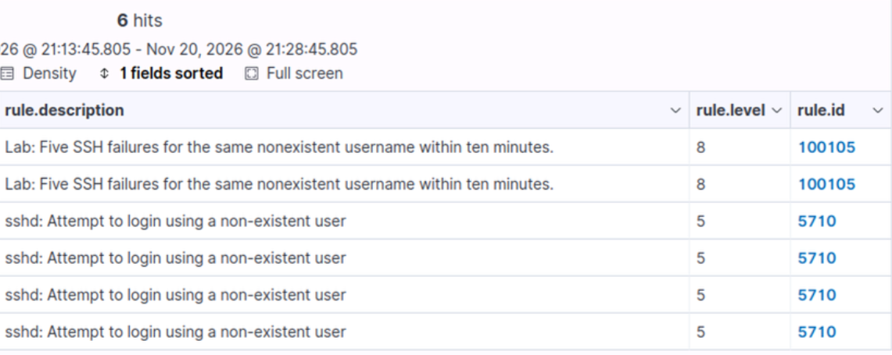

# Detecting repeated SSH sign-in failures with Wazuh

I built this lab to answer a specific question: if five SSH failures arrive from one address, does it matter whether they target one username or two? On an Ubuntu VM in Azure Lab Services, I wrote a Wazuh rule that counts failures for each nonexistent username. In a six-event run, the fifth and sixth entries triggered my rule. Five failures split three and two across usernames produced zero custom alerts.



## How the lab worked

I used Azure Log Analytics to prototype the logic in KQL with fictional sign-ins. I ran Wazuh 4.14.10 on Ubuntu 22.04.5 LTS for the live alert tests. The Linux logger command wrote synthetic SSH messages into journald. Wazuh decoded the username and source IP and displayed matching alerts in Threat Hunting. All authentication activity described here was simulated.

## Tests and evidence

| Input | Observed result |
|---|---|
| Ten invalid-user messages from one source | The built-in rules produced nine single-event alerts (5710) and one burst alert (5712). [Burst evidence](screenshots/builtin-burst.png) |
| One failed password followed by a success | Wazuh recorded 5760 then 5715. No burst alert appeared. [Retry evidence](screenshots/password-retry.png) |
| Five messages for the same username in the rule tester | Custom rule 100105 matched on the fifth input. [Replay evidence](screenshots/rule-replay.png) |
| Five messages for one username in the first live test | All five matched 5710. Replaying the messages matched 100105. The cause remains open. |
| Six messages for one fresh username | Four matched 5710. Two matched 100105. I verified the fifth and sixth inputs using ports 52005 and 52006. |
| Five messages split across two fresh usernames | All five matched 5710. Neither username reached five. [Control evidence](screenshots/split-user-control.png) |

## Explore the project

- [Investigation report](REPORT.md) — case narrative, evidence and limitations.
- [Wazuh rule](rules/signin_lab_rules.xml) — level 8, frequency 5, timeframe 600 seconds, grouped by decoded source username.
- [KQL exercises](queries/) — run each file independently in Azure Log Analytics KQL mode. The sample rows are embedded in each query.

## Repeat the live comparison

On an existing lab manager collecting journald, install the XML in `/var/ossec/etc/rules/`, validate with `sudo /var/ossec/bin/wazuh-analysisd -t`, then restart the manager. Use fresh usernames for each run so previous failures fall outside the comparison. These commands generate local log messages.

```bash
for n in {1..6}; do
  /usr/bin/logger -p authpriv.warning -t sshd "Failed password for invalid user repeat-a from 192.0.2.32 port $((52000 + n)) ssh2"
  /usr/bin/sleep 1
done

for user in control-a control-b control-a control-b control-a; do
  /usr/bin/logger -p authpriv.warning -t sshd "Failed password for invalid user $user from 192.0.2.33 port 53000 ssh2"
  /usr/bin/sleep 1
done
```

In Threat Hunting → Events, search each source separately with `data.srcip:"192.0.2.32"` or `data.srcip:"192.0.2.33"`. Keep every rule ID visible. Compare the hit count with the number of inputs, then open the custom alerts and inspect the port in `full_log`.
